  

Hi! I make things work. Most of the time.

### Things I've built

- **[amxts](https://github.com/amxts/amxts)**: Counter-Strike 1.6 plugins in TypeScript, compiled ahead of time and run inside AMX Mod X.
- **[amxts-cli](https://github.com/amxts/amxts-cli)**: a project generator and a build tool with live reload.
- **[amxts-vscode](https://github.com/amxts/amxts-vscode)**: a VS Code extension with completion and checks for config files.
- Modules on top: [config-core](https://github.com/amxts/config-core), [menu-core](https://github.com/amxts/menu-core), [resemiclip](https://github.com/amxts/resemiclip), [ftp](https://github.com/amxts/ftp).
- A few things that aren't public: a game client, web apps.
